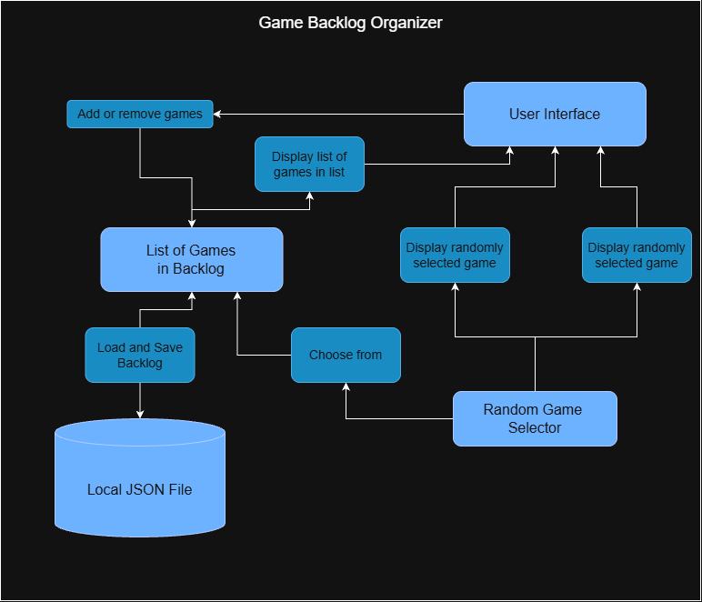

# Project Name

Game Backlog Selector

## How It Works

An app where you can put in all the games on your backlog, and it will randomly choose a game for you to play from that list, potentially with filters if you have a specific preference for genre

## Tech Stack

 - **Language**: Java
 - **Libraries**:
    - Java Swing to create the UI
    - Java file I/O for saving/loading
 - Local JSON file used for storing the backlog

## Roadmap

- Allow for filtering the backlog by genre or some other tag
- Allow users to categorize games by things such as backlog, playing, or completed
- Connect to steam API to grab the cover images of games in the backlog and display them

## Author

Sahil Tallapaneni
